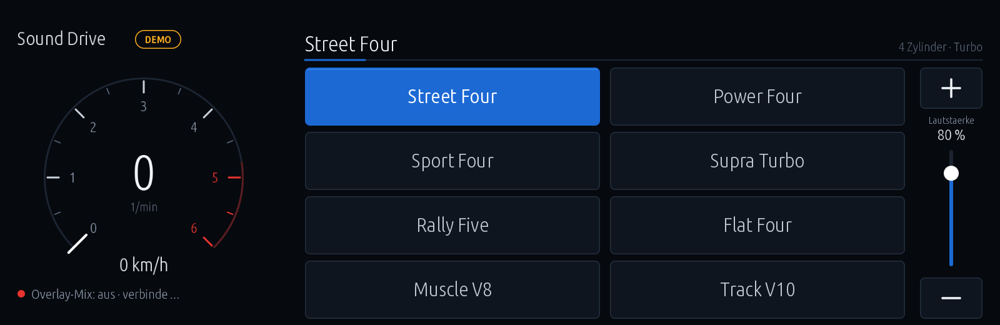

<h1 align="center">Sound Drive</h1>

<p align="center">
  <b>Virtueller Motorsound für BMW mit iDrive 7 (MGU) – über die eigenen Lautsprecher, gesteuert von
  echter Drehzahl und Last.</b><br>
  Entwickelt und im Alltag gefahren in einem BMW 220d (G42). Installierbar über den MGU Store.
</p>

<p align="center">
  
  
  
  
</p>

<p align="center">
  
</p>

> **Hinweis.** Inoffizielles Hobbyprojekt, nicht von der BMW AG unterstützt oder mit ihr verbunden.
> Änderungen am eigenen Head Unit erfolgen auf eigenes Risiko. Lautstärke vernünftig wählen, damit
> Warn- und Umgebungsgeräusche hörbar bleiben.

---

## Was Sound Drive macht

Sound Drive (früher „Iconix Sounds“) erzeugt live einen Motorsound und spielt ihn über die Fahrzeuglautsprecher ab – ähnlich
wie BMWs eigenes „Active Sound Design“, aber mit wählbarem Charakter. Grundlage sind die echten
Fahrzeugdaten: Drehzahl, Motormoment (Last) und Geschwindigkeit. Gibst du Gas, wird der Sound voller;
beim Gleiten bleibt er dezent im Hintergrund, im Schub blubbert er leise aus.

- **Klingt wie im Innenraum, nicht wie ein Synthesizer.** Jeder Zylinder erzeugt pro Zündung einen
  Abgas-Druckimpuls (echte Zündfolge), der durch eine nachgebildete Auspuffanlage läuft: Krümmer,
  Hauptrohr, Schalldämpfer. Dazu kommt Körperschall über Motorlager und Karosserie. Die Karosserie
  dämpft die Höhen – so wie man einen Motor im Auto wirklich hört.
- **Keine schrillen Töne, keine Knackser, kein Rauschen.** Kein Pfeifen, keine Patscher, kein
  Ansaugrauschen, kein Zischen. Prüfwerkzeuge im Repository messen das automatisch.
- **Oben im Drehzahlband lauter,** wie ein echter Motor – auch bei Teillast.
- **Folgt dem Fahrmodus:** In Eco Pro dezent und dumpfer, in Comfort normal, in Sport lauter, offener und
  bellender, in Sport+ noch etwas mehr. Der Wechsel geht weich über etwa eine Sekunde.
- **Lauter bei hohem Tempo:** ab 50 km/h steigt der Sound sanft an, bei 130 km/h um +2, +4 oder +6 dB (einstellbar),
  damit er gegen Wind- und Abrollgeräusche ankommt.
- **Startsound:** Beim Motorstart dreht der Starter kurz durch, der Motor springt an, dreht hoch und fällt auf
  Leerlauf – passend zum gewählten Profil (abschaltbar).
- **Startet von selbst** mit dem Auto und läuft im Hintergrund – die App muss nicht geöffnet werden. Wann, bestimmt das
  Head Unit (nach einem Kaltstart rund 55 Sekunden nach dem Einschalten); die Audio-Diagnose zeigt die Zeiten. Schont das Head Unit
  (Klangberechnung direkt in 24 kHz, wenige Millisekunden Rechenzeit pro Sekunde Ton).

### Die Profile

| Profil | Charakter |
|---|---|
| **Power Four** (Standard) | Kräftiger Vierzylinder, auf das schmale Drehzahlband eines Diesels abgestimmt: oben satt statt dünn. |
| **Supra** | Reihensechser im Supra-Stil: seidig und rauchig, dreht frei hoch. |
| **Flat Four** | Vierzylinder-Boxer: Ungleich lange Krümmer je Seite geben das bekannte Grummeln. |
| **Flat Six** | Sechszylinder-Boxer: kehlig und sonor, dreht frei hoch. |
| **Rally Five** | Fünfzylinder: Die ungerade Zündfolge gibt das typische Trällern, rau und kehlig. |
| **Muscle V8** | Cross-Plane-V8 mit dem typischen ungleichmäßigen Blubbern. |
| **Track V10** | Voller, dichter Zehnzylinder. |
| **Grand V12** | Seidig und mächtig, singt oben heraus. |

Street Four und Sport Four sind seit Version 1.0.6 im neuen Power Four aufgegangen (eine gespeicherte Auswahl wird
umgestellt).

**Hörproben** (so, wie sie im Auto ankommen: 24 kHz mono; Leerlauf, Vollgas bis 4800 U/min, Schub,
Konstantfahrt, Teillast):
[Power Four](docs/audio/sounddrive_power_four.wav) ·
[Supra](docs/audio/sounddrive_supra.wav) ·
[Flat Four](docs/audio/sounddrive_flat_four.wav) ·
[Flat Six](docs/audio/sounddrive_flat_six.wav) ·
[Rally Five](docs/audio/sounddrive_turbo5.wav) ·
[Grand V12](docs/audio/sounddrive_v12.wav)

### Bedienung und Einstellungen

- Profil und Lautstärke per Antippen wählen (den Lautstärke-Regler auch antippen oder ziehen) – große Knöpfe, zwei je Reihe, gut während der Fahrt zu treffen; der
  iDrive-Knopf und die Lautstärkeregelung des Autos bleiben unangetastet
- Lautstärke 0–100 % (100 % ist so laut wie früher 150 %: leise Passagen deutlich lauter, Spitzen begrenzt), **Ausprägung** (wie stark der Sound mit der Last aufmacht), Sport-Boost, stumm im Stand
- **Sound folgt dem Fahrmodus** (abschaltbar); die Seite nutzt die ganze Breite (**Schmale Ansicht** lässt Platz für
  das Seitenfenster der geteilten Ansicht). Reiter **Sound** im Kopf führt aus den Einstellungen zurück
- **Lautstärkeknopf:** Läuft Musik über **CarPlay** (oder Android Auto), mischt Sound Drive den Motorsound direkt in die
  Musik: Die Musik wird nicht abgesenkt, nichts pausiert, der Knopf gehört der Musik. Ohne solche Musik
  (Pause, Radio, Bluetooth) nimmt die App den Overlay-Weg. Den behandelt das Auto wie eine Durchsage: Es senkt die Musik ab
  und gibt ihm den Knopf. Darum tritt der Motorsound dort beim Drehen kurz zur Seite (abschaltbar) und kommt 1–3 Sekunden
  nach dem letzten Drehen zurück.
- **Motorsound unabhängig vom Lautstärkeknopf** (Standard: Normal): Die App liest die Lautstärke des Autos mit und regelt
  den Motorsound sofort gegenläufig – er bleibt beim Drehen gleich laut, eingestellt wird er nur mit dem Regler in der App.
- **Lautstärke abgleichen:** Wie viel lauter eine Stufe am Knopf macht, ist nicht überall gleich. Im Stand, Musik an, in den
  Einstellungen einschalten: Ein gleichmäßiger Motorton läuft, und auf der Sound-Seite stellen **+** und **−** ihn bei der
  jetzigen Auto-Lautstärke nach. Einmal bei normaler Lautstärke beginnen, dann leiser und lauter drehen und jeweils
  nachstellen, bis der Motor gleich laut klingt. Dazwischen rechnet die App, der Abgleich bleibt gespeichert. Beim Losfahren
  schaltet er sich ab. Grenze: Bei sehr leiser Musik lässt sich der Motorsound nicht beliebig anheben, denn beide laufen
  durch denselben Verstärkereingang.
- **Bei Telefon/Ansagen leiser:** Telefonate, Sprachassistent, Parkpiepser und Warngongs senken den Motorsound um
  etwa 12 dB ab; Navigationsansagen bewusst nicht
- **Klang anpassen:** Bass (Dröhnen) ±6 dB und Auspuff-Bellen 50–150 % (wie weit Schalldämpfer und Innenraum
  öffnen) – für jedes Profil
- **Motor anpassen:** Leerlauf- und Abregeldrehzahl sowie maximales Drehmoment des eigenen Motors – der Sound
  bildet das echte Drehzahlband auf das Profil ab
- **Experten:** Tonweg und Lastquelle (zum Ausprobieren in anderen Autos)
- **Testsound:** 9 Sekunden Leerlauf → Vollgas → Schub, auch im Stand
- **BMW-Lautstärkeanzeige:** BMWs eigener Lautstärkebalken läge sonst unter der Seite. Beim Drehen tritt sie für 2,5 Sekunden
  zurück (abschaltbar): BMWs Anzeige ist zu sehen, die Seite steht solange als Bild dahinter
- **Audio-Diagnose** in klaren Worten: ein Satz zum Gesamtzustand, darunter sechs Karten (Audio-Dienst, Daten vom Auto,
  Tonweg, Ton, Lautstärke, Start) mit Ampel und Tipp, was zu tun ist. **Technische Details** zeigt Verbindungen, Quellen,
  Kanäle und Ringpuffer (auch im QR-Log)
- **QR log** in den Einstellungen: das Log als QR-Codes zum Abfotografieren (für ein Issue ohne SSH)

### So kommt der Ton in die Lautsprecher

Store-Apps haben keine Audio-Schnittstelle. Deshalb erzeugt das Tool **Sound Drive Audio** (ein kleiner
Dienst auf dem Head Unit) den Sound und schreibt ihn in einen Audiokanal des BMW-Systems (SmartX). Die
App bittet den BMW-Audiomanager, diesen Kanal mit den Lautsprechern zu verbinden – nur solange Ton
gebraucht wird.

Der **Tonweg** ist in den Einstellungen unter „Experten“ wählbar. Standard ist **Automatisch**:

- **In der Musik:** Solange CarPlay oder Android Auto Musik spielt, addiert der Dienst den Motorsound auf die Musik im
  gemeinsamen Speicher (SmartX-Ringpuffer), kurz bevor das Auto sie abholt. Er öffnet keinen Kanal und braucht keine
  Verbindung. Der Aufbau des Puffers wird vorher streng geprüft; passt etwas nicht, bleibt der Speicher unangetastet und
  es gilt der Overlay-Weg. Wird es zu laut für beides, gibt die Musik kurz bis 2,5 dB nach.
- **Overlay-Mix:** sonst. Der Motorsound liegt als eigener Kanal über der Musik, die weiterläuft, aber abgesenkt wird.

Weitere Wege (CarLife exklusiv, CarLife-Navi) sind zum Ausprobieren in anderen Autos gedacht. Wege auf andere Senken (MainSink,
zweiter Verstärker-Eingang) hat das Auto im Test abgelehnt.

Die Verbindung im Audiomanager braucht im Auto rund 6 Sekunden, bis sie hörbar ist. Darum baut Sound Drive sie schon
auf, wenn das Auto aufwacht, und hält sie, solange der Motor läuft – so kommt der Ton beim Anlassen sofort. Bis die
Verbindung steht (oder wenn eine CarPlay-Ansage sie kurz übernimmt), bleibt der Sound leise und blendet danach weich
ein, statt abgehackt einzusetzen. Der Player läuft mit Echtzeit-Priorität, damit er auch auf einem ausgelasteten
Head Unit nicht zu spät kommt (sonst knistert es).

Der Overlay-Kanal ist mono. Ein räumlicher Klang (Auspuff hinten, Motor vorne) würde zwei getrennte Kanäle
auf Front- und Hecklautsprecher brauchen; das gibt der Audiomanager bisher nicht her.

---

## Installation

Voraussetzung ist ein iDrive 7 (MGU) mit Root-Zugang und installiertem
[MGU Store](https://github.com/robertnisipeanu/mgu-store).

1. Im MGU Store dieses Repository als Quelle hinzufügen: `Nico1003/sound-drive`
2. **Sound Drive** installieren. Das Tool **Sound Drive Audio** kommt als Abhängigkeit automatisch mit.
   (Wer „Iconix Sounds“ schon hat, bekommt den neuen Namen einfach als Update.)
3. App öffnen, **Testsound** drücken – fertig. Updates kommen über den Store.

Klappt es nicht auf Anhieb: In der Statuszeile sollte „In der CarPlay-Musik“ oder „Overlay-Mix: verbunden“ stehen. Wenn nicht,
**Audio-Diagnose** öffnen, ein Foto machen, den nächsten **Tonweg** probieren und gern ein
[Issue](https://github.com/Nico1003/sound-drive/issues) mit dem Foto anlegen.

| Komponente | Version |
|---|---|
| Sound Drive (App) | 1.1.0 |
| Sound Drive Audio (Tool) | 1.1.0 |

---

## Außerdem: Fahrstil-Coach

<p align="center">
  
</p>

Die zweite App in diesem Repository (Version 1.0.3) bewertet jede Fahrt live und im Rückblick, ähnlich
einem Fahrlehrer auf dem Beifahrersitz:

- **Wertung von 0 bis 100** aus sieben Kategorien: Vorausschau, Beschleunigen, Kurven, Ruhe,
  Drehzahl, Motorschonung und Leerlauf
- **Wasserglas,** das mit den echten Längs- und Querkräften schwappt und bei ruppiger Fahrweise
  verschüttet
- **Live-Tipps** (kalter Motor, Drehzahl, Turbo abkühlen lassen), **Verlauf** mit Wochenvergleich,
  **Level und 15 Abzeichen**
- Coach-Modus Eco, Ausgewogen oder Sportlich – „Auto“ folgt dem Fahrerlebnisschalter
- Läuft im Hintergrund und erkennt Fahrtbeginn und -ende selbst

<table>
  <tr>
    <td></td>
    <td></td>
  </tr>
  <tr>
    <td align="center"><sub>Fahrt: Kategorien, Ereignisse, Kennzahlen</sub></td>
    <td align="center"><sub>Verlauf: Wertung der letzten Fahrten</sub></td>
  </tr>
</table>

---

## Für Entwickler

| Pfad | Inhalt |
|---|---|
| `apps/iconix_sounds/` | Sound Drive: `main.js`, `ui.js`, `car_route.js` (Tonweg), `audio_link.js` (zum Dienst), `vehicle_feed.js`, `diagnose.js` |
| `tools/iconix-audiod/` | Audio-Dienst: Klang (`synth.js`, `profiles.js`), Takt (`engine.js`), Ausgabe und Mischen (`alsa_play.py`) |
| `apps/drive_coach/` | Fahrstil-Coach: `coach.js` (Bewertung), `goals.js` (Level, Abzeichen), `main.js` |
| `kit/runtime/` | Laufzeit des Kits (Bildschirm, Signale, Einstellungen), wird in jede App gepackt |
| `kit/tools/` | `build.py` (baut die App auf dem Head Unit), Tests und Klang-Werkzeuge |
| `mgu-repo.json` | was der MGU Store aus diesem Repository anbietet |

Alles läuft mit Node, ohne Auto:

```bash
node kit/tools/test_quick.js
```

(kurz, unter 15 s; `--full` prüft alles samt Dauertests und braucht einige Minuten)

```bash
node kit/tools/iconix_calibrate.js --wav docs/sounds --rate 24000
```

Dieselben Prüfungen laufen bei jedem Push als GitHub-Action (`.github/workflows/app-tests.yml`).

`test_iconix_route.js` prüft Tonweg, Diagnose, Oberfläche und Klang (keine Höhen, keine Knackser, kaum
Rauschen); `iconix_calibrate.js` misst Pegel und Klangbild je Profil und schreibt Hörproben;
`iconix_popscan.js` sucht in einer Fahrt mit Schaltvorgängen nach Knacksern; `test_alsa_play.py` prüft den
Python-Player mit einer simulierten Soundkarte; `test_engine_e2e.js` startet den Dienst mit echtem Player-Prozess und
misst die Verzögerung; `test_daemon.js` startet den ganzen Dienst als Prozess und spricht ihn über seinen Socket an
(wie die App); `iconix_soak.js` fährt jedes Profil in jedem Fahrmodus und jeder Lautstärke durch alle
Fahrsituationen (Kaltstart mit Startsound, Schalten, Kickdown, Schub, Telefon, Profil- und Moduswechsel, Stumm,
Datenlücke, Extremwerte, Abwürgen), auch mit den Klang-Reglern in beiden Extremen, und prüft auf NaN, Übersteuern,
Knacken und Stille.

Der Klang folgt dem physikalisch informierten Ansatz von Baldan et al. (2015, „Physically informed car
engine sound synthesis“) und den offenen Projekten
[engine-sound-lab](https://github.com/geoffmyers/engine-sound-lab) und
[ice-engine-simulator](https://github.com/daveruiz/ice-engine-simulator) (Ideen und Größenordnungen,
kein übernommener Code).

Die Apps basieren auf dem Kit aus
[cauliflowermossgrape/idrive7-apps](https://github.com/cauliflowermossgrape/idrive7-apps); dieses
Repository enthält nur den Teil, den die beiden Apps brauchen. Doku zum Kit:
[Originalprojekt](https://github.com/cauliflowermossgrape/idrive7-apps#readme) (englisch).

---

## Danksagung

- [cauliflowermossgrape/idrive7-apps](https://github.com/cauliflowermossgrape/idrive7-apps):
  Kit, Laufzeit und Build
- [Robert Nisipeanu / MGU Store](https://github.com/robertnisipeanu/mgu-store): Store und Renderer
- Der Audiomanager-Weg folgt dem, was Moonride (JustAnotherPU),
  [M850i-amn/idrive7-apps](https://github.com/M850i-amn/idrive7-apps) und
  [loenne007/idrive-enginesound](https://github.com/loenne007/idrive-enginesound) dokumentiert haben; von dort
  stammt auch die Beobachtung, dass der Lautstärkeknopf bei der Haupt-Senke sichtbar ist und das Auto die Quelle wie
  eine Durchsage behandelt (eigene Umsetzung, kein übernommener Code)
- Der Aufbau des SmartX-Ringpuffers ist aus Intels offenem Quelltext abgelesen
  ([intel/AVB-AudioModules](https://github.com/intel/AVB-AudioModules), BSD-3-Clause; eigene Umsetzung); dass CarPlay genau
  diesen Puffer benutzt, hat [NamelsMissing/mgu-apps](https://github.com/NamelsMissing/mgu-apps) beobachtet
- Die Eingänge des Verstärkers haben
  [Vizualyse/idrive-apps](https://github.com/Vizualyse/idrive-apps) und [pllanaio/bmw-airplay](https://github.com/pllanaio/bmw-airplay) dokumentiert
  (eigene Umsetzung)

## Lizenz

[MIT](LICENSE), wie das Kit des Originalprojekts.
